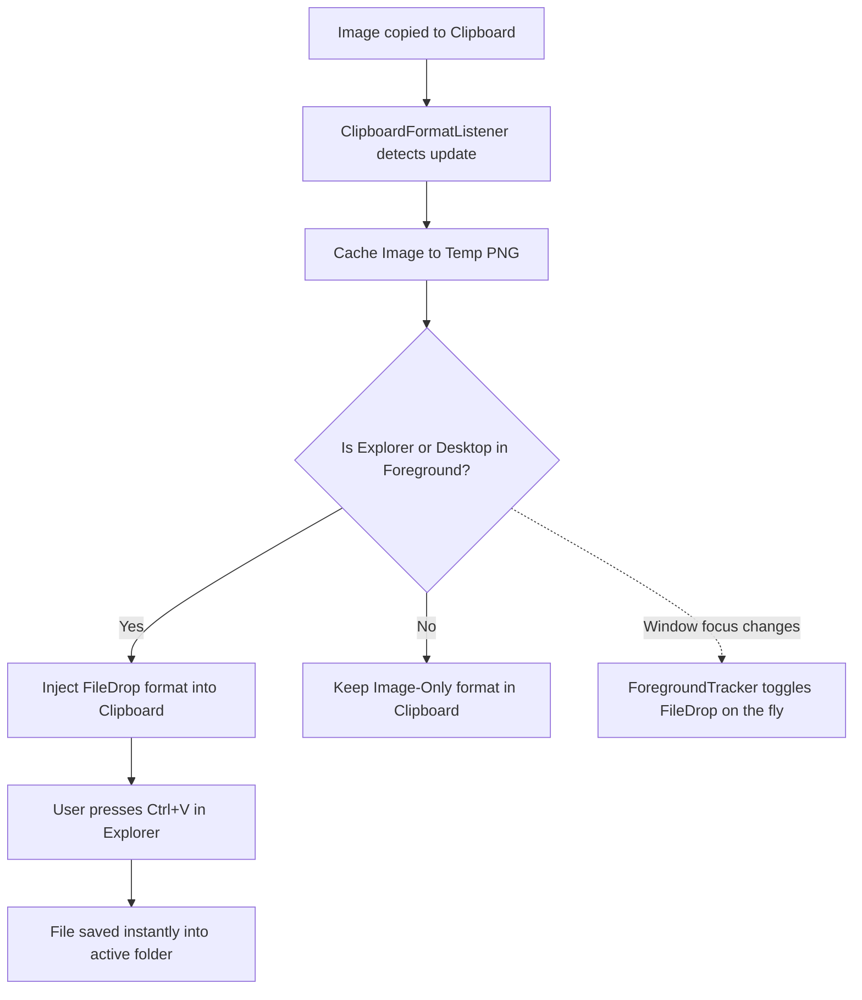

<div align="center">

# 📋 ClipboardImageDrop

**Seamlessly paste clipboard images directly into Windows Explorer folders and Desktop.**

[](https://github.com/mykolakushch/ClipboardImageDrop/actions/workflows/build.yml)
[](https://github.com/mykolakushch/ClipboardImageDrop/actions/workflows/release.yml)


<p align="center">
  <a href="#key-features">Key Features</a> •
  <a href="#how-it-works">How It Works</a> •
  <a href="#installation">Installation</a> •
  <a href="#usage">Usage</a> •
  <a href="#building-from-source">Building from Source</a> •
  <a href="#architecture">Architecture</a>
</p>

---

</div>

## 💡 Overview

Normally, pressing `Ctrl + V` in Windows Explorer or on the Desktop does nothing when you have an image in your clipboard (copied from a web browser, Slack, Telegram, or taken via Snipping Tool `Win + Shift + S`).

**ClipboardImageDrop** is an ultra-lightweight Windows system tray utility that solves this problem. It monitors the clipboard and foreground window state to dynamically inject `FileDrop` capabilities, enabling instant file pasting (`.png`) anywhere in Windows Explorer.

---

## ✨ Key Features

- **Instant Pasting**: Press `Ctrl + V` in any Explorer folder or the Desktop to immediately save your clipboard image as a timestamped PNG file.
- **Smart Window Tracking**: Only injects the file format when Windows Explorer or the Desktop is focused. Other applications receive the standard bitmap image without interference.
- **Clipboard History Friendly**: Prevents temp files from polluting the native Windows Clipboard History (`Win + V`) or Cloud Clipboard sync.
- **Single Instance & System Tray**: Runs unobtrusively in the background with custom tray status icons (Active / Paused).
- **Auto & Manual Cleanup**: Automatically purges obsolete temporary images and provides a quick manual cleanup action from the tray menu.
- **Single-File Executable**: Completely self-contained, requiring no external dependencies or installer.

---

## ⚙️ How It Works



1. **Clipboard Monitoring**: Uses Win32 `AddClipboardFormatListener` to receive notifications on clipboard changes.
2. **Foreground Window Hook**: Uses `SetWinEventHook` to track when Explorer windows (`CabinetWClass`, `ExploreWClass`, `Progman`, `WorkerW`) gain or lose focus.
3. **Dynamic Format Injection**: When Explorer is in the foreground, it augments the clipboard's data object with a `FileDrop` list pointing to a generated PNG. When navigating away, it reverts to image-only format to preserve native application behavior.

---

## 🚀 Installation

### Option 1: Download Precompiled Binary (Recommended)
1. Go to the [Releases](https://github.com/mykolakushch/ClipboardImageDrop/releases) page.
2. Download the latest `ClipboardImageDrop-win-x64.zip` or standalone `ClipboardImageDrop.exe`.
3. Extract and run `ClipboardImageDrop.exe`.

### Auto-start on Windows Boot (Optional)
To have the application start automatically with Windows:
1. Press `Win + R`, type `shell:startup`, and press **Enter**.
2. Create a shortcut to `ClipboardImageDrop.exe` inside this folder.

---

## 🖱️ Usage

Once started, the application runs quietly in the Windows system tray:

- **Double-click Tray Icon**: Toggle between **Active** and **Paused**.
- **Right-click Tray Icon**:
  - **Активно (Active)**: Enable or disable clipboard interception.
  - **Очистити тимчасові файли (Clear Temp Files)**: Remove generated temp screenshots.
  - **Вихід (Exit)**: Shut down the utility cleanly.

---

## 🛠️ Building from Source

### Prerequisites
- [.NET 8.0 SDK](https://dotnet.microsoft.com/download/dotnet/8.0)
- Windows 10 (Build 1809+) or Windows 11 (x64)

### Build
```bash
git clone https://github.com/mykolakushch/ClipboardImageDrop.git
cd ClipboardImageDrop
dotnet build ClipboardImageDrop.sln -c Release
```

### Publish Single-File Executable
```bash
dotnet publish src/ClipboardImageDrop/ClipboardImageDrop.csproj `
  -c Release `
  -r win-x64 `
  --self-contained true `
  -p:PublishSingleFile=true `
  -p:EnableCompressionInSingleFile=true `
  -p:IncludeNativeLibrariesForSelfExtract=true `
  -o ./dist
```

The resulting standalone executable will be located in `./dist/ClipboardImageDrop.exe`.

---

## 📁 Repository Structure

```
ClipboardImageDrop/
├── .github/
│   └── workflows/
│       ├── build.yml               # CI build & verification on push/PR
│       └── release.yml             # CD automated release packaging on tag push
├── src/
│   └── ClipboardImageDrop/
│       ├── ClipboardImageDrop.csproj  # WinExe .NET 8 project
│       ├── ClipboardMonitor.cs        # Native clipboard listener & file injection
│       ├── ForegroundTracker.cs       # WinEvent hook for Explorer window detection
│       ├── NativeMethods.cs           # Win32 user32 P/Invoke signatures
│       ├── Program.cs                 # App entry point with single-instance mutex
│       └── TrayApplicationContext.cs  # System tray UI, icons & context menu
├── .gitignore                      # .NET, VS, Rider, and temporary files ignore
├── ClipboardImageDrop.sln          # Solution file
├── ClipboardImageDrop.slnx         # Modern XML Solution file
└── README.md                       # Documentation
```

---

## 📄 License

This project is licensed under the [MIT License](LICENSE).
